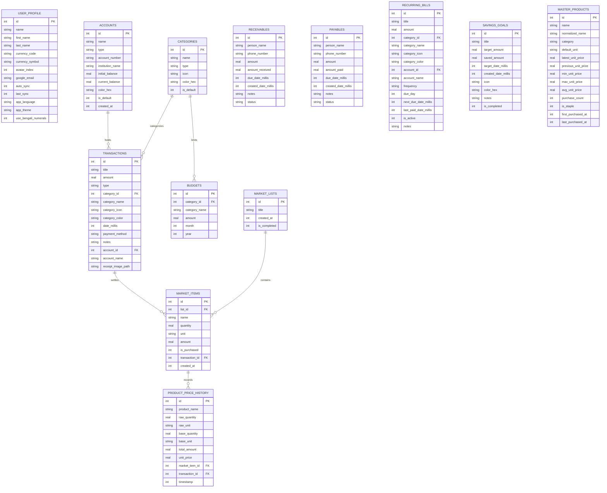

# Comprehensive Application Audit Report: Expense Tracker (হিসাব কিতাব)

> **Auditor**: Senior Product Designer & Mobile Systems Engineer  
> **Target Project**: `/Users/sabbir/Dev/ExpenseTracker`  
> **App Version**: `v6.21` (versionCode `85`)  
> **Target Package**: `com.example.expensetracker`  
> **Date**: November 12, 2026  
> **Scope**: Architecture, Project Structure, Screens & Navigation, Feature Inventory, Data Model & Flow, Design System & Theming, UX & Usability Problems, Technical Constraints, and Engineering Conventions.

---

## 1. OVERVIEW

### 1.1 App Purpose & Value Proposition
**Expense Tracker (হিসাব কিতাব)** is a privacy-first, 100% offline-first personal financial management and household economy mobile application. It is tailored for the Bangladeshi / South Asian socioeconomic context, incorporating:
- Bilingual interface (English & Bengali/বাংলা).
- Full Bengali numeral support (১, ২, ৩...) for tabular financial calculations.
- Native Mobile Financial Services (MFS) integration (bKash, Nagad, Rocket, Upay) alongside traditional Cash in Hand and Bank accounts.
- Informal debt ledger (ধার ও দেনা / Receivables & Payables) with partial installment logging and bill splitting among friends/roommates.
- A dedicated Bazaar / Grocery Market Checklist engine with aisle organization (কাঁচাবাজার, মাছ-মাংস, ডেইরি, মুদি), real-time price logging, commodity price intelligence, unit conversion, and WhatsApp bulk message parser.
- Branded PDF and CSV statement generation and export.
- Private cloud backup & restore directly to the user's personal Google Drive `AppDataFolder` (no third-party servers).

### 1.2 Target Users
1. **Households & Family Budget Managers**: Daily grocery shopping, utility bill tracking, family budget limits.
2. **Students & Roommates**: Shared living costs, mess bills, meal splitting, peer-to-peer loan tracking.
3. **Freelancers & Small Business Operators**: Multi-wallet balance tracking, cash-flow monitoring across bank accounts and MFS wallets, income categorizations.

### 1.3 Platform & Execution Environment
- **Platform**: Native Android only. (No Web, iOS, or cross-platform codebases are present).
- **Minimum SDK (`minSdk`)**: API 24 (Android 7.0 Nougat).
- **Target SDK (`targetSdk`)**: API 35 (Android 15).
- **Compile SDK (`compileSdk`)**: API 36.

### 1.4 Tech Stack & Key Dependencies
Extracted directly from [app/build.gradle.kts](file:///Users/sabbir/Dev/ExpenseTracker/app/build.gradle.kts) and [gradle/libs.versions.toml](file:///Users/sabbir/Dev/ExpenseTracker/gradle/libs.versions.toml):

| Layer | Technology / Library | Version | Role & Notes |
|---|---|---|---|
| **Language** | Kotlin | `2.3.20` | JVM toolchain 17 target |
| **UI Framework** | Jetpack Compose | BOM `2026.03.01` | Declarative UI, 100% Compose |
| **Design System** | Material 3 (`androidx.compose.material3`) | Compose BOM | Styled with custom "Living Ledger" design tokens |
| **Icons** | Material Icons Extended | Compose BOM | Comprehensive iconography |
| **Lifecycle & State** | `androidx.lifecycle` | `2.10.0` | `lifecycle-runtime-compose`, `lifecycle-viewmodel-compose` |
| **Asynchronous Engine** | Kotlin Coroutines | `1.10.2` | `StateFlow`, `MutableStateFlow`, structured concurrency |
| **Routing / Navigation** | Custom State Machine + Navigation 3 Runtime | `1.0.1` (declared) | Custom enum-driven state transitions with 3D canvas drawer |
| **Local Database** | Android SQLite (`SQLiteOpenHelper`) | Schema v15 | WAL enabled, foreign keys enabled, modular table helpers |
| **Key-Value Store** | AndroidX DataStore Preferences | `1.1.1` | Settings, privacy mode flags, budget notification memory |
| **Serialization** | Kotlinx Serialization JSON | `1.8.0` | Type-safe JSON backup dumps and model parsing |
| **Cloud Services** | Google Drive API & Play Services Auth | `v3-rev20241027-2.0.0` / `21.3.0` | Google Sign-In & private Drive AppData backup |
| **Background Jobs** | AndroidX WorkManager | `2.10.0` | Automated daily cloud backup & budget reminder workers |
| **HTTP Client** | Google HTTP Client Gson | `1.45.1` | REST client used by Google Drive API client |
| **Testing** | JUnit 4, Coroutines Test, Espresso | `4.13.2` / `1.10.2` / `3.7.0` | 471 unit test cases in opaque-box test suite |
| **Build Tooling** | Gradle & Android Gradle Plugin (AGP) | `9.0.1` | Kotlin DSL (`build.gradle.kts`), ProGuard/R8 enabled |

---

## 2. PROJECT STRUCTURE

```
ExpenseTracker/
├── app/
│   ├── build.gradle.kts                 # Module-level Gradle configuration (minSdk 24, targetSdk 35)
│   ├── proguard-rules.pro               # ProGuard / R8 keep rules
│   └── src/
│       ├── main/
│       │   ├── AndroidManifest.xml      # App permissions, activities, file providers
│       │   ├── java/com/example/expensetracker/
│       │   │   ├── common/              # Global constants, text parsers, unit converter engine (3 files)
│       │   │   ├── data/                # Data access layer (42 files)
│       │   │   │   ├── drive/           # Google Sign-In & Drive REST sync managers (2 files)
│       │   │   │   ├── local/           # SQLiteOpenHelper, table delegates, migrations, seeds (25 files)
│       │   │   │   ├── model/           # Kotlinx serializable entities & domain models (13 files)
│       │   │   │   ├── repository/      # Repository facade & domain-specific slices (10 files)
│       │   │   │   ├── update/          # In-app GitHub update checker and APK downloader (1 file)
│       │   │   │   └── worker/          # WorkManager daily sync and budget reminder workers (2 files)
│       │   │   ├── theme/               # Living Ledger tokens: Color, Shape, Theme, Type (4 files)
│       │   │   ├── ui/                  # UI Presentation Layer (283 files)
│       │   │   │   ├── accounts/        # Accounts & MFS multi-wallet management (20 files)
│       │   │   │   ├── analytics/       # Visual analytics, KPI strips, donut & bar charts (8 files)
│       │   │   │   ├── bills/           # Recurring bills, commitments, payment alerts (13 files)
│       │   │   │   ├── budget/          # Category budgets, monthly caps, savings goals (11 files)
│       │   │   │   ├── components/      # Reusable widgets, OneUI cards, headers, calculators (44 files)
│       │   │   │   ├── dashboard/       # Home overview screen, quick actions, widgets (22 files)
│       │   │   │   ├── market/          # Market / grocery checklist screen & in-store dock (4 files)
│       │   │   │   ├── navigation/      # 3D Scaffold, bottom nav bar, side drawer, routes (12 files)
│       │   │   │   ├── receivables/     # Debt book: money owed (receivables) & payables (40 files)
│       │   │   │   ├── reports/         # PDF/CSV statement exports, date range ledgers (11 files)
│       │   │   │   ├── savings/         # Savings goals cards, visual rings, contributions (12 files)
│       │   │   │   ├── settings/        # Categories editor, theme/language, Drive backup (25 files)
│       │   │   │   ├── share/           # Slip generation, image/pdf/text receipt share (12 files)
│       │   │   │   └── transactions/    # Transaction ledger, filter bar, add/edit form (39 files)
│       │   │   ├── utils/               # Receipt image camera/gallery helper (1 file)
│       │   │   ├── ExpenseTrackerApp.kt # Application class: WorkManager init, channel setup
│       │   │   └── MainActivity.kt      # Single Activity entry point with Compose setContent
│       │   └── res/                     # Android XML resources, mipmaps, drawables, strings.xml
│       └── test/java/com/example/expensetracker/ # Unit & integration test suite (46 test files)
├── gradle/
│   ├── libs.versions.toml               # Centralized dependency catalog
│   └── wrapper/                         # Gradle wrapper binaries & properties
├── scripts/
│   └── bump_version.sh                  # Automated version bumping script (Major/Minor/Patch)
├── AGENTS.md / GEMINI.md                # Engineering guidelines, release policies, git hooks
├── build.gradle.kts                     # Root build script
├── settings.gradle.kts                  # Project name & module resolution
└── README.md                            # High-level product overview
```

### Main Directories & Functional Responsibilities
- [app/src/main/java/com/example/expensetracker/common/](file:///Users/sabbir/Dev/ExpenseTracker/app/src/main/java/com/example/expensetracker/common/): Holds application-wide invariants (`AppConstants.kt`), regex-based NLP text parser for WhatsApp grocery lists (`MarketListParser.kt`), and unit normalization engine (`UnitConverterEngine.kt`).
- [app/src/main/java/com/example/expensetracker/data/local/](file:///Users/sabbir/Dev/ExpenseTracker/app/src/main/java/com/example/expensetracker/data/local/): Implements the SQLite persistence architecture. The central `ExpenseDatabaseHelper.kt` delegates table-specific CRUD, cursor mapping, and indexing to 15 specialized table helper classes (e.g., `TransactionTableHelper.kt`, `MarketTableHelper.kt`, `AccountBalanceHelper.kt`).
- [app/src/main/java/com/example/expensetracker/data/repository/](file:///Users/sabbir/Dev/ExpenseTracker/app/src/main/java/com/example/expensetracker/data/repository/): Central repository singleton (`ExpenseRepository.kt`) exposed as Kotlin StateFlows, modularized across domain slices using Kotlin extension files (`ExpenseRepositoryAccountsAndBudgets.kt`, `ExpenseRepositoryMarketCompletion.kt`, etc.).
- [app/src/main/java/com/example/expensetracker/theme/](file:///Users/sabbir/Dev/ExpenseTracker/app/src/main/java/com/example/expensetracker/theme/): The "Living Ledger" design token system containing color schemes, tabular typography scales, and shape tokens.
- [app/src/main/java/com/example/expensetracker/ui/navigation/](file:///Users/sabbir/Dev/ExpenseTracker/app/src/main/java/com/example/expensetracker/ui/navigation/): Orchestrates the 3D scaffold animation, persistent bottom dock navigation, side drawer panel, and screen hosts.

---

## 3. SCREENS & NAVIGATION

### 3.1 Screen Catalog

| Screen / Page | Route Identifier (`NavigationItem`) | Source File | Purpose | Main Visual & Functional Elements |
|---|---|---|---|---|
| **Dashboard** | `HOME` | [DashboardScreen.kt](file:///Users/sabbir/Dev/ExpenseTracker/app/src/main/java/com/example/expensetracker/ui/dashboard/DashboardScreen.kt) | Central financial command center | `OneUiHeader`, `BalanceCard` (Net balance, Income, Expense, Budget progress), `DashboardQuickActionsDock`, `UpcomingBillsAlertBanner`, `DashboardRecentTransactionsSection`, `ActiveMarketListDashboardCard`, `DashboardDebtsLedgerWidget`, `DashboardSavingsGoalsWidget`. |
| **Transactions** | `TRANSACTIONS` | [TransactionsScreen.kt](file:///Users/sabbir/Dev/ExpenseTracker/app/src/main/java/com/example/expensetracker/ui/transactions/TransactionsScreen.kt) | Complete historical ledger | `TransactionsTopBar`, `TransactionsFilterBar` (search input, type switcher, category/account dropdowns, date filters), Day-grouped transaction rows with day income/expense totals, `TransactionSwipeRow` (swipe-to-delete), PDF/CSV export dialog trigger. |
| **Market & Groceries** | `MARKET` | [MarketScreen.kt](file:///Users/sabbir/Dev/ExpenseTracker/app/src/main/java/com/example/expensetracker/ui/market/MarketScreen.kt) | In-store shopping companion & price tracker | 3 Pager Tabs (`HorizontalPager`): **Tab 0** (Active checklist with department stalls, 1-swipe check-off, in-store dock with running total and checkout), **Tab 1** (Commodity price intelligence & sparklines), **Tab 2** (Notepad list creation wizard with WhatsApp bulk text paste). |
| **Analytics** | `ANALYTICS` | [AnalyticsScreen.kt](file:///Users/sabbir/Dev/ExpenseTracker/app/src/main/java/com/example/expensetracker/ui/analytics/AnalyticsScreen.kt) | Spending breakdown & trends | `AnalyticsTopBar`, Time filter bar (Today, This Week, This Month, This Year, All), `AnalyticsKpiStrip` (daily average, savings rate, highest expense), Donut charts (Categories vs Payment Methods), Ranking cards, 7-day spending bar chart (`SpendingBarChart`). |
| **Accounts & Wallets** | `ACCOUNTS` | [AccountsScreen.kt](file:///Users/sabbir/Dev/ExpenseTracker/app/src/main/java/com/example/expensetracker/ui/accounts/AccountsScreen.kt) | Multi-wallet & bank account management | `AccountsHeroCard` (Net worth, Bank, MFS, Cash), Quick actions row (Transfer, Add), `DigitalAccountCard` (realistic credit/MFS cards with EMV chip), Account details sheet, Reconcile balance dialog, Transfer funds sheet. |
| **Bills & Subscriptions** | `BILLS` | [BillsScreen.kt](file:///Users/sabbir/Dev/ExpenseTracker/app/src/main/java/com/example/expensetracker/ui/bills/BillsScreen.kt) | Recurring obligations & subscriptions | `BillsTopBar`, `BillsSummaryHeroCard` (Monthly commitment, active count, overdue/due soon alerts), `RecurringBillCardItem` (amount, frequency, due day, Pay Now trigger, active toggle), `PayBillSheet`, `AddEditBillSheet`. |
| **Money Owed (Debts)** | `RECEIVABLES` | [ReceivablesScreen.kt](file:///Users/sabbir/Dev/ExpenseTracker/app/src/main/java/com/example/expensetracker/ui/receivables/ReceivablesScreen.kt) | Informal debt book (ধার ও দেনা) | `ReceivablesTopBar` with Split Bill button, `ReceivablesTabsAndNetBanner` (toggle Receivables vs Payables, Net position), Summary card, Borrower/Lender cards with payment progress, `RecordPaymentSheet`, `BillSplitterSheet`. |
| **Budgets & Goals** | `BUDGETS` | [BudgetScreen.kt](file:///Users/sabbir/Dev/ExpenseTracker/app/src/main/java/com/example/expensetracker/ui/budget/BudgetScreen.kt) | Spending limits & savings targets | Header tabs switcher (`BUDGETS` vs `SAVINGS_GOALS`). **Budgets**: `DailySafeSpendBanner`, Overall monthly budget card, Category budget cards. **Savings Goals**: Target progress rings, `AddEditSavingsGoalSheet`, `AddSavingsContributionSheet`. |
| **Reports & Statements** | `REPORTS` | [ReportsScreen.kt](file:///Users/sabbir/Dev/ExpenseTracker/app/src/main/java/com/example/expensetracker/ui/reports/ReportsScreen.kt) | Formal audit statements & data export | Period selector (This Month, Quarter, Year, Custom), KPI summaries, 1-tap Export Branded PDF Statement, Export CSV Spreadsheet, Itemized running balance ledger. |
| **Settings & Cloud** | `SETTINGS` | [SettingsScreen.kt](file:///Users/sabbir/Dev/ExpenseTracker/app/src/main/java/com/example/expensetracker/ui/settings/SettingsScreen.kt) | Profile, preferences & Google Drive sync | `SettingsProfileCard`, Theme selector (Dark, Light, AMOLED, System), Language selector, Bengali numerals toggle, Category management accordion, Google Drive cloud backup/restore with safety snapshot, About app. |

### 3.2 Modal & Global Sheets

| Sheet / Dialog | Trigger Location | Source File | Purpose |
|---|---|---|---|
| **Add/Edit Transaction** | Bottom Nav center `+` button; list edit clicks | [AddEditTransactionSheet.kt](file:///Users/sabbir/Dev/ExpenseTracker/app/src/main/java/com/example/expensetracker/ui/transactions/AddEditTransactionSheet.kt) | Multi-mode form (Expense, Income, Transfer, Market); in-place calculator; account selector; category picker; camera/gallery receipt attachment. |
| **Global Action Chooser** | Bottom Nav center `+` button (Long Press) | [GlobalActionChooserSheet.kt](file:///Users/sabbir/Dev/ExpenseTracker/app/src/main/java/com/example/expensetracker/ui/navigation/GlobalActionChooserSheet.kt) | Fast shortcut menu: Add Expense, Add Income, Transfer Funds, Open Market Checklist. |
| **Share Expense Slip** | Top bars in Transactions, Analytics, Dashboard | [ShareExpenseSheet.kt](file:///Users/sabbir/Dev/ExpenseTracker/app/src/main/java/com/example/expensetracker/ui/share/ShareExpenseSheet.kt) | Renders shareable receipt image slip, branded PDF statement, or WhatsApp formatted text breakdown. |
| **Bill Splitter** | Dashboard, Receivables screen, Global actions | [BillSplitterSheet.kt](file:///Users/sabbir/Dev/ExpenseTracker/app/src/main/java/com/example/expensetracker/ui/receivables/BillSplitterSheet.kt) | Divides total amount across friends, deducts payer account, creates receivable debt entries automatically. |
| **Upcoming Budget Prompt**| App launch on 1st of month | [UpcomingBudgetPromptDialog.kt](file:///Users/sabbir/Dev/ExpenseTracker/app/src/main/java/com/example/expensetracker/ui/components/UpcomingBudgetPromptDialog.kt) | Prompts user to roll over or adjust previous month's category budgets for the new calendar month. |

### 3.3 Navigation Structure & Flow Architecture
The application uses a hybrid **Bottom Navigation + 3D Canvas Drawer** architecture managed in [AppNavigation.kt](file:///Users/sabbir/Dev/ExpenseTracker/app/src/main/java/com/example/expensetracker/ui/navigation/AppNavigation.kt):
1. **Primary Screen Switching**:
   - The persistent bottom bar ([ModernBottomNavBar.kt](file:///Users/sabbir/Dev/ExpenseTracker/app/src/main/java/com/example/expensetracker/ui/navigation/ModernBottomNavBar.kt)) provides 1-tap switching between `Home`, `Transactions`, `Market`, and the `More` drawer trigger.
   - The central elevated button triggers transaction logging (short tap) or the action chooser (long press).
2. **3D Scaffold Drawer**:
   - Tapping `More` on the bottom bar (or swiping from the right edge) engages [Navigation3DScaffold.kt](file:///Users/sabbir/Dev/ExpenseTracker/app/src/main/java/com/example/expensetracker/ui/navigation/Navigation3DScaffold.kt). The active screen scales down to `0.84f`, shifts left by up to `320.dp`, rotates in 3D (`rotationY = 8f`), and acquires rounded corners (`26.dp`) to reveal [SideMenuDrawer.kt](file:///Users/sabbir/Dev/ExpenseTracker/app/src/main/java/com/example/expensetracker/ui/navigation/SideMenuDrawer.kt).
   - The drawer houses secondary destinations: `Accounts`, `Analytics`, `Budgets`, `Reports`, `Bills`, `Money Owed`, and `Settings`.
3. **Screen Hierarchy & Back Handling**:
   - Secondary screens feature a top back-arrow (`←`) that navigates back to `HOME`.
   - Android system back gestures are captured via `BackHandler`:
     - If the 3D drawer is open -> closes drawer.
     - If on any secondary screen -> navigates back to `HOME`.
     - If on `HOME` -> exits the application.

---

## 4. FEATURES

### 4.1 Fully Working Features
1. **Income & Expense Tracking**:
   - Add, edit, view, and delete income and expense transactions.
   - Account selection with balance validation (warning displayed if spending exceeds current account balance).
   - Category assignment with custom icons and color palettes.
   - Date and time picker with relative quick shortcuts (Today, Yesterday, -2d, -3d).
   - Offline receipt photo attachment (capture via camera or pick from gallery, compressed and persisted locally in app storage).
   - In-place calculator in the amount input card supporting expressions (`+`, `-`, `×`, `÷`).
   - Swipe-to-delete with undo action via Snackbar.
2. **Search & Multi-Facet Filtering**:
   - Real-time text search across transaction titles, category names, notes, and account names.
   - Filter chips for transaction types (All, Expense, Income, Transfer, Market Trips).
   - Dropdown selectors for specific accounts and categories.
   - Time period filtering: Today, This Week, This Month, Last Month, This Year, and Custom Date Range.
3. **Bazaar & Market Checklist Engine**:
   - Creation of multiple named shopping lists.
   - WhatsApp / SMS bulk paste parser extracting item names, quantities, and units via regex.
   - Department aisle stall grouping (🥬 কাঁচাবাজার, 🐟 মাছ ও মাংস, 🥛 দুধ ও বেকারি, 🧂 মুদি সদাই) with live completion progress counters.
   - 1-swipe right check-off gesture with emerald reveal and haptic feedback.
   - Persistent bottom dock showing spent total, completed count, and 1-tap checkout.
   - In-store price entry dialog with numeric keypad, calculator operator bar, and historical rate variance alert.
   - Forgot staples prompt (alerts if essential spices/chili/lemon are missing when shopping >= 3 items).
   - Atomic trip completion creating a unified expense transaction, updating product price history, and updating master commodity records.
4. **Multi-Account & Wallet System**:
   - Supports Cash, Bank, and Mobile Financial Services (bKash, Nagad, Rocket, Upay).
   - Current balance and initial balance tracking.
   - Inter-account fund transfers with paired transaction recording.
   - Balance reconciliation tool with automatic adjustment entries.
   - Digital card UI with custom gradient styling and simulated EMV chip.
5. **Recurring Bills & Commitments**:
   - Frequencies: Monthly, Weekly, Yearly.
   - Dynamic payment status calculation: Paid, Overdue, Due Soon (<= 4 days), Upcoming.
   - 1-tap "Pay Now" flow: deducts from chosen account, records expense, advances next due date.
   - WorkManager reminder notifications for upcoming and overdue bills.
6. **Debt Book & Peer Loans (ধার ও দেনা)**:
   - Receivables (Money lent to others) and Payables (Money borrowed from others).
   - Partial installment recording with remaining balance calculations.
   - Net debt position banner (Total Lent minus Total Borrowed).
   - WhatsApp / SMS direct sharing for payment reminders.
   - Bill Splitter: divides total amount among friends and automatically creates individual receivable entries.
7. **Budgets & Savings Goals**:
   - Overall monthly spending ceiling and category-specific spending caps.
   - Daily Safe Spend calculation: remaining budget divided by remaining days in month.
   - Visual progress bars with threshold color-coding (Emerald < 75%, Turmeric 75–99%, Terracotta >= 100%).
   - Automatic rollover prompt at the start of each month.
   - Savings goals with target amounts, target dates, progress rings, and deposit contribution flows.
8. **Reporting & Data Export**:
   - Branded PDF financial statement generation with itemized table and summary KPIs.
   - CSV export with UTF-8 BOM encoding for Excel / Google Sheets compatibility.
   - Shareable visual receipt slips rendered as bitmaps.
9. **Cloud Sync & Data Portability**:
   - Google Drive backup & restore to hidden `AppDataFolder`.
   - Pre-restore safety snapshot (creates local timestamped `.bak` database and JSON dump before restore).
   - Automated daily background sync via WorkManager (`DailySyncWorker`).
   - Local JSON export and import.
   - In-app update check against GitHub releases API (`AppUpdateManager.kt`).
10. **Localization & Accessibility**:
    - Full English and Bengali bilingual support.
    - Bengali numerals toggle for all amounts and dates.
    - 4 theme modes: Dark, Light, Pure Black AMOLED, and System Default.
    - Privacy Mode toggle: masks all financial figures with bullets (`••••••`).

### 4.2 Half-Built, Missing, or Deprecated Features
1. **Multi-Currency Support**:
   - **Status**: *Missing / Incomplete*.
   - **Details**: The app has a `currencySymbol` and `currencyCode` in `UserProfile` (defaulting to `৳` / `BDT`), but the `Transaction` entity itself has no currency field. All transactions are assumed to be in the single global currency. There is no support for recording expenses in multiple currencies (e.g., USD during travel) or live/manual exchange rate conversions.
2. **Recurring Income**:
   - **Status**: *Missing*.
   - **Details**: `RecurringBill` only models recurring expenses/commitments. There is no automated recurring income feature (e.g., monthly salary auto-deposit or regular freelance retainer).
3. **Receipt OCR / Automatic Scanning**:
   - **Status**: *Purged / Manual Only*.
   - **Details**: Receipts can be photographed or picked from the gallery and stored locally, but there is no OCR or AI receipt scanner. Earlier Gemini AI scanning experiments were explicitly purged (verified by `OfflineReceiptAndAiPurgeVerificationTest.kt`) to ensure privacy and offline stability.
4. **Android Navigation 3 Architecture**:
   - **Status**: *Unused Dead Dependency*.
   - **Details**: `androidx.navigation3.ui` and `androidx.navigation3.runtime` (`1.0.1`) are declared in `build.gradle.kts`, but the navigation flow in `AppNavigation.kt` is implemented via manual state switching (`when (selectedItem)`). The Navigation 3 library is not actively used for routing.
5. **Biometric App Lock**:
   - **Status**: *Missing*.
   - **Details**: While Privacy Mode masks balance figures on screen, there is no biometric (fingerprint/face) or PIN gate to lock the app when launched.
6. **Multi-Device Cloud Merge / Conflict Resolution**:
   - **Status**: *Basic Overwrite*.
   - **Details**: Google Drive sync writes a single JSON snapshot file (`ExpenseTracker_Backup.json`). If multiple devices back up to the same Drive account, the latest backup overwrites the previous one; there is no delta synchronization or conflict merge resolution.

---

## 5. DATA MODEL

### 5.1 Entities and Fields



### 5.2 Data Storage and Flow Architecture
1. **Local SQLite Database (`expense_tracker.db`)**:
   - Managed via [ExpenseDatabaseHelper.kt](file:///Users/sabbir/Dev/ExpenseTracker/app/src/main/java/com/example/expensetracker/data/local/ExpenseDatabaseHelper.kt).
   - Write-Ahead Logging (WAL) and Foreign Key constraints are enabled in `onConfigure`.
   - Comprehensive indexing is established on query-heavy columns (`idx_tx_date`, `idx_tx_account`, `idx_budgets_month_year`, `idx_pph_name_time`).
2. **Repository & StateFlow Layer**:
   - [ExpenseRepository.kt](file:///Users/sabbir/Dev/ExpenseTracker/app/src/main/java/com/example/expensetracker/data/repository/ExpenseRepository.kt) acts as a single source of truth.
   - When database mutations occur, repository methods reload local queries on `Dispatchers.IO` and emit updated immutable lists through `StateFlow` streams.
   - ViewModels collect these StateFlows using `collectAsStateWithLifecycle()` to prevent background battery drain.
3. **Receipt Media Storage**:
   - Attached images are scaled and compressed (JPEG, 85% quality, max dimension 1280px) and saved to internal private storage at `context.filesDir/receipts/` by [ReceiptImageHelper.kt](file:///Users/sabbir/Dev/ExpenseTracker/app/src/main/java/com/example/expensetracker/utils/ReceiptImageHelper.kt). The SQLite `transactions.receipt_image_path` column stores the relative file path.
4. **Cloud Backup Flow**:
   - `ExpenseRepositoryBackup.kt` dumps all SQLite tables into a type-safe [BackupPayload](file:///Users/sabbir/Dev/ExpenseTracker/app/src/main/java/com/example/expensetracker/data/model/BackupPayload.kt) JSON string using Kotlinx Serialization.
   - `GoogleDriveSyncManager.kt` authenticates via Google Play Services, writes the JSON to the hidden `AppDataFolder` on Google Drive, and records the timestamp in `user_profile.last_sync`.

---

## 6. CURRENT UI / DESIGN SYSTEM

### 6.1 Design Concept: "The Living Ledger & Tactile Bazaar"
The application uses a custom design system inspired by a blend of **Samsung One UI** and physical paper bookkeeper ledgers ("Living Ledger"). It replaces heavy nested container cards with clean sheet surfaces and `0.5.dp` ink hairline dividers.

### 6.2 Color Palette Tokens

Defined in [app/src/main/java/com/example/expensetracker/theme/Color.kt](file:///Users/sabbir/Dev/ExpenseTracker/app/src/main/java/com/example/expensetracker/theme/Color.kt) and [Theme.kt](file:///Users/sabbir/Dev/ExpenseTracker/app/src/main/java/com/example/expensetracker/theme/Theme.kt):

| Semantic Token | Dark Theme (Slate) | Light Theme (Parchment) | AMOLED (Pure Black) | Semantic Purpose |
|---|---|---|---|---|
| `background` | `#0E1116` | `#F9F8F5` | `#000000` | Canvas background; reduced OLED glare in dark mode |
| `surface` | `#161B22` | `#FFFFFF` | `#0A0D14` | Primary paper/sheet surface for cards and sheets |
| `surfaceVariant` | `#1F2633` | `#F3EFE8` | `#121722` | Secondary tonal container (status bars, chips) |
| `border` / `divider` | `#262E3B` | `#E5DFD5` | `#191F2C` | Soft hairline separator (`0.5.dp`) |
| `borderDashed` | `#2E3847` | `#D6CEBF` | `#222938` | Dashed border for empty states |
| `textPrimary` | `#F3F4F6` / `#FFFFFF` | `#1C1917` / `#0F172A` | `#FFFFFF` | High-contrast body text and card titles |
| `textSecondary` | `#9CA3AF` / `#9DA3B4` | `#57534E` / `#475569` | `#9CA3AF` | Subtitles, labels, secondary metadata (WCAG AA) |
| `textMuted` | `#6B7280` / `#7E8597` | `#78716C` / `#64748B` | `#6B7280` | Timestamps, micro-annotations |
| `accent` | `#10B981` (Cardamom Emerald) | `#047857` (Forest Emerald) | `#10B981` | Primary CTA, active list indicator (WCAG AA $\ge$ 4.5:1) |
| `income` | `#10B981` | `#047857` | `#10B981` | Income metrics, savings positive status |
| `expense` | `#F43F5E` (Terracotta Rose) | `#BE123C` (Rich Terracotta) | `#F43F5E` | Expense metrics, cost overruns, deletion actions |
| `warning` | `#F59E0B` (Turmeric) | `#B45309` (Amber Turmeric) | `#F59E0B` | Overdue bills, 75-99% budget warnings |
| `info` | `#6366F1` (Iris Blue) | `#4338CA` (Deep Iris) | `#6366F1` | Analytics, transfers, statement exports |

### 6.3 Typography Scale

Defined in [app/src/main/java/com/example/expensetracker/theme/Type.kt](file:///Users/sabbir/Dev/ExpenseTracker/app/src/main/java/com/example/expensetracker/theme/Type.kt):
- **Font Family**: System Default sans-serif (`FontFamily.Default`).
- **Tabular Numbers Feature**: `fontFeatureSettings = "tnum"` is applied globally across all text styles to guarantee vertical alignment of numeric financial columns.
- **Bengali Readability Invariant**: Minimum font size for Bengali metadata is constrained to $\ge 12\text{sp}$ with line-height $\ge 16\text{sp}$ to prevent clipping of vowel diacritics (কার ও ফলা).

| Style Token | Font Size | Line Height | Weight | Letter Spacing | Primary Usage |
|---|---|---|---|---|---|
| `headlineLarge` | `32.sp` | `38.sp` | Bold (`700`) | `-0.5.sp` | Hero balance totals |
| `headlineMedium`| `24.sp` | `30.sp` | SemiBold (`600`) | `0.sp` | Key metric values, screen headers |
| `titleLarge` | `18.sp` | `24.sp` | SemiBold (`600`) | `0.sp` | Top bar titles, dialog headlines |
| `titleMedium` | `15.sp` | `22.sp` | SemiBold (`600`) | `0.sp` | Card headers, section titles |
| `titleSmall` | `14.sp` | `20.sp` | Medium (`500`) | `0.sp` | Row headers, item names |
| `bodyLarge` | `14.sp` | `20.sp` | Regular (`400`) | `0.sp` | Primary form inputs, notes |
| `bodyMedium` | `13.5.sp` | `19.sp` | Regular (`400`) | `0.sp` | List item secondary descriptions |
| `bodySmall` | `12.sp` | `17.sp` | Regular (`400`) | `0.sp` | Subtitles, date stamps |
| `labelMedium` | `12.sp` | `16.sp` | SemiBold (`600`) | `0.sp` | Badges, status tags |
| `labelSmall` | `12.sp` | `16.sp` | Medium (`500`) | `0.sp` | Tab labels, chip metadata |

### 6.4 Spacing, Corner Radii & Shadows
Defined in [app/src/main/java/com/example/expensetracker/theme/Shape.kt](file:///Users/sabbir/Dev/ExpenseTracker/app/src/main/java/com/example/expensetracker/theme/Shape.kt):
- **Border Radii**:
  - `RadiusOuterSheet = 22.dp`: Modal bottom sheets, primary balance cards.
  - `RadiusCardGroup = 16.dp`: Standard cards (`AppCard`, `OneUiCard`), summary cards.
  - `RadiusActionChip = 10.dp`: Filter chips, calculator keys, interactive pills.
  - `RadiusBadgeTag = 6.dp`: Compact status tags, count indicators.
- **Hairline Dividers**: `HairlineInkStroke = 0.5.dp`. Replaces thick dividers with razor-thin ink borders.
- **Standard Spacing**:
  - Horizontal Screen Padding: `16.dp`.
  - Card Internal Padding: `16.dp`.
  - Vertical Gap between Cards: `12.dp`.
  - List Row Vertical Padding: `10.dp`.
- **Elevation & Shadows**: Flat aesthetic (default card elevation `0.dp`) relying on border outlines and surface contrast. Floating elements use deliberate shadows:
  - Bottom Navigation Bar: `16.dp` elevation.
  - Central Add Button: `6.dp` elevation with ambient color glow.
  - 3D Drawer Surface: `16.dp` elevation during animation.

### 6.5 Reusable Components Library
Located in [app/src/main/java/com/example/expensetracker/ui/components/](file:///Users/sabbir/Dev/ExpenseTracker/app/src/main/java/com/example/expensetracker/ui/components/):
- **Cards & Surfaces**: [OneUiComponents.kt](file:///Users/sabbir/Dev/ExpenseTracker/app/src/main/java/com/example/expensetracker/ui/components/OneUiComponents.kt) (`AppCard`, `OneUiCard`, `HairlineDivider`, `EmptyStateCard`), [OneUiBalanceCard.kt](file:///Users/sabbir/Dev/ExpenseTracker/app/src/main/java/com/example/expensetracker/ui/components/OneUiBalanceCard.kt).
- **Headers**: [OneUiHeader.kt](file:///Users/sabbir/Dev/ExpenseTracker/app/src/main/java/com/example/expensetracker/ui/components/OneUiHeader.kt) (avatar button, user greeting, formatted date).
- **Inputs & Calculators**: [InPlaceCalculator.kt](file:///Users/sabbir/Dev/ExpenseTracker/app/src/main/java/com/example/expensetracker/ui/components/InPlaceCalculator.kt), [CalculatorEvaluator.kt](file:///Users/sabbir/Dev/ExpenseTracker/app/src/main/java/com/example/expensetracker/ui/components/CalculatorEvaluator.kt), [FilterChips.kt](file:///Users/sabbir/Dev/ExpenseTracker/app/src/main/java/com/example/expensetracker/ui/components/FilterChips.kt).
- **Visual Feedback & Haptics**: [AppHaptics.kt](file:///Users/sabbir/Dev/ExpenseTracker/app/src/main/java/com/example/expensetracker/ui/components/AppHaptics.kt), [MiddleScreenConfirmationOverlay.kt](file:///Users/sabbir/Dev/ExpenseTracker/app/src/main/java/com/example/expensetracker/ui/components/MiddleScreenConfirmationOverlay.kt), [ConfettiCelebration.kt](file:///Users/sabbir/Dev/ExpenseTracker/app/src/main/java/com/example/expensetracker/ui/components/ConfettiCelebration.kt).
- **Charts**: [AnalyticsCharts.kt](file:///Users/sabbir/Dev/ExpenseTracker/app/src/main/java/com/example/expensetracker/ui/components/AnalyticsCharts.kt) (Custom Canvas Donut Chart), [SpendingBarChart.kt](file:///Users/sabbir/Dev/ExpenseTracker/app/src/main/java/com/example/expensetracker/ui/components/SpendingBarChart.kt).
- **Export Engines**: [StatementPdfBuilder.kt](file:///Users/sabbir/Dev/ExpenseTracker/app/src/main/java/com/example/expensetracker/ui/components/StatementPdfBuilder.kt), [StatementCsvBuilder.kt](file:///Users/sabbir/Dev/ExpenseTracker/app/src/main/java/com/example/expensetracker/ui/components/StatementCsvBuilder.kt).

---

## 7. UX PROBLEMS & DEFICIENCIES

A rigorous review of every screen and interaction flow reveals the following specific UX issues:

### 7.1 Information Architecture & Navigation Friction
1. **Buried Primary Destinations behind 3D Drawer**:
   - **File**: [app/src/main/java/com/example/expensetracker/ui/navigation/ModernBottomNavBar.kt](file:///Users/sabbir/Dev/ExpenseTracker/app/src/main/java/com/example/expensetracker/ui/navigation/ModernBottomNavBar.kt#L66-L73), [SideMenuDrawer.kt](file:///Users/sabbir/Dev/ExpenseTracker/app/src/main/java/com/example/expensetracker/ui/navigation/SideMenuDrawer.kt#L201-L210)
   - **Problem**: Core financial workflows—such as `Budgets`, `Analytics`, and `Accounts & Wallets`—are not present on the bottom navigation bar. Instead, they are hidden inside the `More` 3D side drawer. Accessing them requires: tap "More" $\rightarrow$ wait for 3D canvas slide animation $\rightarrow$ locate row in vertical list $\rightarrow$ tap item.
2. **Dual-Hierarchy Navigation Ambiguity on Secondary Screens**:
   - **File**: [app/src/main/java/com/example/expensetracker/ui/navigation/AppNavigation.kt](file:///Users/sabbir/Dev/ExpenseTracker/app/src/main/java/com/example/expensetracker/ui/navigation/AppNavigation.kt#L149-L172)
   - **Problem**: When a user navigates to a secondary screen from the drawer (e.g. `AccountsScreen`, `BillsScreen`, `ReportsScreen`), a top back-arrow (`←`) appears, but the `ModernBottomNavBar` remains visible at the bottom of the screen with the `More` icon highlighted. This creates mental model confusion: the user is simultaneously presented with hierarchical stack navigation (`←`) and persistent bottom tabs, without a clear parent-child visual anchor.
3. **Hidden Action Menu Gesture**:
   - **File**: [app/src/main/java/com/example/expensetracker/ui/navigation/ModernBottomNavBar.kt](file:///Users/sabbir/Dev/ExpenseTracker/app/src/main/java/com/example/expensetracker/ui/navigation/ModernBottomNavBar.kt#L148-L151)
   - **Problem**: Opening the `GlobalActionChooserSheet` (which contains quick actions for Add Income, Transfer Funds, and Market List) requires a long press on the central `+` button. There is no visual affordance or hint indicating that a long press exists.

### 7.2 Transaction Logging Flow & Keyboard Friction
4. **Too Many Taps & Modal Stacking to Log Non-Expense Transactions**:
   - **File**: [app/src/main/java/com/example/expensetracker/ui/transactions/AddEditTransactionSheet.kt](file:///Users/sabbir/Dev/ExpenseTracker/app/src/main/java/com/example/expensetracker/ui/transactions/AddEditTransactionSheet.kt#L64-L100)
   - **Problem**: Tapping `+` opens `AddEditTransactionSheet` defaulting to `EXPENSE`. To log Income, the user must tap the tiny type switcher pill at the top of the sheet. Furthermore, tapping the Category dropdown opens another bottom sheet / dialog on top of the already open modal sheet, resulting in nested modal stutter on low-to-mid-range Android devices.
5. **Soft Keyboard Obscuring Form Fields**:
   - **File**: [app/src/main/java/com/example/expensetracker/ui/transactions/TransactionAmountInputField.kt](file:///Users/sabbir/Dev/ExpenseTracker/app/src/main/java/com/example/expensetracker/ui/transactions/TransactionAmountInputField.kt)
   - **Problem**: In `AddEditTransactionSheet`, when the amount input field gains focus, the Android IME keyboard opens and pushes the sheet upward. On screens with height $< 720\text{dp}$, the category selector, account selector, and save button are pushed completely off-screen, requiring manual scrolling while the keyboard is open.
6. **Inconsistent Numeric Input Across Modules**:
   - **Files**: [MarketPromptAmountDialog.kt](file:///Users/sabbir/Dev/ExpenseTracker/app/src/main/java/com/example/expensetracker/ui/dashboard/MarketPromptAmountDialog.kt), [TransactionAmountInputField.kt](file:///Users/sabbir/Dev/ExpenseTracker/app/src/main/java/com/example/expensetracker/ui/transactions/TransactionAmountInputField.kt)
   - **Problem**: In the Market module, price logging uses a custom thumb-zone numeric keypad with large touch targets and instant operator chips (`+`, `-`, `×`, `÷`). In contrast, the primary Transaction entry sheet uses the standard system keyboard with smaller keys and no operator bar, creating an inconsistent mental model.

### 7.3 Visual Hierarchy & Dashboard Cognitive Overload
7. **Dashboard Vertical Scrolling Clutter**:
   - **File**: [app/src/main/java/com/example/expensetracker/ui/dashboard/DashboardScreen.kt](file:///Users/sabbir/Dev/ExpenseTracker/app/src/main/java/com/example/expensetracker/ui/dashboard/DashboardScreen.kt#L111-L287)
   - **Problem**: The Dashboard lazy column stacks up to 8 dense widgets: `BalanceCard`, `DashboardQuickActionsDock`, `UpcomingBillsAlertBanner`, `DashboardRecentTransactionsSection`, `ActiveMarketListDashboardCard` (with multi-list chips), `DashboardDebtsLedgerWidget`, and `DashboardSavingsGoalsWidget`. When a user has active data in all modules, the dashboard spans over 2,500 vertical pixels, making it difficult to scan critical financial KPIs at a glance.
8. **Missing Suggestions in Empty States**:
   - **Files**: [BillsScreen.kt](file:///Users/sabbir/Dev/ExpenseTracker/app/src/main/java/com/example/expensetracker/ui/bills/BillsScreen.kt#L101-L115), [SavingsGoalsTabContent.kt](file:///Users/sabbir/Dev/ExpenseTracker/app/src/main/java/com/example/expensetracker/ui/budget/SavingsGoalsTabContent.kt)
   - **Problem**: Empty states show a generic dashed box and "Add" button. They do not offer onboarding starter templates or one-tap recommendations (e.g. "Add Electricity Bill", "Add WiFi Subscription", "Create Emergency Fund Goal").
9. **Ephemeral Toast Feedback for Critical Cloud Operations**:
   - **File**: [app/src/main/java/com/example/expensetracker/ui/settings/SettingsScreen.kt](file:///Users/sabbir/Dev/ExpenseTracker/app/src/main/java/com/example/expensetracker/ui/settings/SettingsScreen.kt#L73-L78)
   - **Problem**: Google Drive backup and restore operations report completion or failure using standard Android `Toast.makeText`. Toasts vanish after a few seconds, are non-actionable, cannot be reviewed in TalkBack accessibility logs, and fail to provide diagnostic details when sync is rejected due to network loss or expired tokens.

### 7.4 Accessibility & Contrast
10. **Touch Targets below 48dp**:
    - **Files**: [MarketSegmentedPills.kt](file:///Users/sabbir/Dev/ExpenseTracker/app/src/main/java/com/example/expensetracker/ui/market/MarketSegmentedPills.kt), [AccountCardMenu.kt](file:///Users/sabbir/Dev/ExpenseTracker/app/src/main/java/com/example/expensetracker/ui/accounts/AccountCardMenu.kt), [FilterChips.kt](file:///Users/sabbir/Dev/ExpenseTracker/app/src/main/java/com/example/expensetracker/ui/components/FilterChips.kt)
    - **Problem**: Several secondary filter chips and menu icons have vertical touch bounding boxes of `32.dp` to `36.dp` without `minimumInteractiveComponentSize()`, violating WCAG 2.2 Level AA guidelines (minimum $48 \times 48\text{dp}$).
11. **Missing Content Descriptions for Screen Readers**:
    - **Files**: [SideMenuDrawer.kt](file:///Users/sabbir/Dev/ExpenseTracker/app/src/main/java/com/example/expensetracker/ui/navigation/SideMenuDrawer.kt#L178), [OneUiComponents.kt](file:///Users/sabbir/Dev/ExpenseTracker/app/src/main/java/com/example/expensetracker/ui/components/OneUiComponents.kt#L167), [AnalyticsCharts.kt](file:///Users/sabbir/Dev/ExpenseTracker/app/src/main/java/com/example/expensetracker/ui/components/AnalyticsCharts.kt)
    - **Problem**: Decorative and informational icons pass `contentDescription = null`. Screen reader users hearing TalkBack are not informed of icon semantics (e.g., trend indicators, payment method logos).

---

## 8. TECHNICAL CONSTRAINTS

### 8.1 Monolithic ViewModels & State Accumulation
- **Constraint**: [DashboardViewModel.kt](file:///Users/sabbir/Dev/ExpenseTracker/app/src/main/java/com/example/expensetracker/ui/dashboard/DashboardViewModel.kt) exposes over 20 distinct `StateFlow` streams (`summary`, `recentDailySpends`, `accounts`, `receivables`, `recurringBills`, `activeMarketLists`, `stapleProducts`, etc.).
- **Impact on Redesign**: Because `DashboardViewModel` is passed down directly into multiple sub-screens and modal hosts ([NavigationScreenHost.kt](file:///Users/sabbir/Dev/ExpenseTracker/app/src/main/java/com/example/expensetracker/ui/navigation/NavigationScreenHost.kt)), changing or refactoring dashboard state boundaries risks breaking downstream contracts across Market, Accounts, and Navigation sheets.

### 8.2 Denormalized Database Schema
- **Constraint**: In [DatabaseSchema.kt](file:///Users/sabbir/Dev/ExpenseTracker/app/src/main/java/com/example/expensetracker/data/local/DatabaseSchema.kt#L36-L53), the `transactions` table contains denormalized snapshot columns: `category_name`, `category_icon`, `category_color`, and `account_name`.
- **Impact on Redesign**: While this improves query speed by avoiding SQL joins on every row, changing a category's name, icon, or color requires bulk updating historical records ([CategoryTableHelper.kt](file:///Users/sabbir/Dev/ExpenseTracker/app/src/main/java/com/example/expensetracker/data/local/CategoryTableHelper.kt)) to prevent visual inconsistency.

### 8.3 Unlinked Paired Transfer Transactions
- **Constraint**: Inter-account fund transfers are represented as two separate transactions in `transactions`: an `EXPENSE` on the source account and an `INCOME` on the target account, tagged with `categoryName = "Transfer"` or `notes = "[Transfer]"`.
- **Impact on Redesign**: There is no `transfer_pair_id` foreign key column linking the two halves of a transfer. If a user edits or deletes one leg of a transfer in the Transactions screen, the opposing leg remains unchanged, potentially desynchronizing the two accounts' balances.

### 8.4 Non-Standard Compose Localization Pattern
- **Constraint**: The project does not use Android's standard `res/values-bn/strings.xml` resource qualifier system. As shown in [app/src/main/res/values/strings.xml](file:///Users/sabbir/Dev/ExpenseTracker/app/src/main/res/values/strings.xml), only `app_name` is present in XML. All UI strings are compiled Kotlin code ([AppStrings.kt](file:///Users/sabbir/Dev/ExpenseTracker/app/src/main/java/com/example/expensetracker/ui/components/AppStrings.kt), [StringsCore.kt](file:///Users/sabbir/Dev/ExpenseTracker/app/src/main/java/com/example/expensetracker/ui/components/StringsCore.kt), [StringsFeatures.kt](file:///Users/sabbir/Dev/ExpenseTracker/app/src/main/java/com/example/expensetracker/ui/components/StringsFeatures.kt)) passed via `LocalAppStrings`.
- **Impact on Redesign**: System-level Android language switching (or Android 13 per-app language settings) will not automatically translate the app; localization changes must go through the internal `SettingsScreen` toggle.

### 8.5 Dual Theme System Layering
- **Constraint**: UI components read color tokens from `LocalAppColors.current` ([AppColors](file:///Users/sabbir/Dev/ExpenseTracker/app/src/main/java/com/example/expensetracker/theme/Theme.kt#L28-L53)) rather than standard `MaterialTheme.colorScheme`.
- **Impact on Redesign**: While `ExpenseTrackerTheme` passes an adapted `ColorScheme` to `MaterialTheme`, any new standard Material 3 components added without explicitly referencing `LocalAppColors.current` may default to standard M3 colors, creating subtle palette mismatches.

---

## 9. EXISTING CONVENTIONS

### 9.1 Rules & Release Invariants ([GEMINI.md](file:///Users/sabbir/Dev/ExpenseTracker/GEMINI.md) / [AGENTS.md](file:///Users/sabbir/Dev/ExpenseTracker/AGENTS.md))
- **Automatic GitHub Push on Successful Updates**:
  Every successful feature, bug fix, or refactor must be verified via `./gradlew testDebugUnitTest`, committed, tagged with an annotated git tag (`vX.Y`), and pushed to `origin main`.
- **Strict 3-Tier Version Bumping Policy**:
  - **Major** (architectural overhauls, major redesigns): Switch to next integer (e.g. `v6.x` $\rightarrow$ `v7.0`). Run `./scripts/bump_version.sh major "<msg>"`.
  - **Minor** (new feature, options, UI improvements): Increment minor version (e.g. `v6.21` $\rightarrow$ `v6.22`). Run `./scripts/bump_version.sh minor "<msg>"`.
  - **Patch** (bug fixes, crash patches): Increment patch version. Run `./scripts/bump_version.sh patch "<msg>"`.
- **3-Point Version Synchronization**:
  Before pushing, three files must match in lockstep:
  1. `app/build.gradle.kts`: `versionCode` and `versionName`.
  2. `app/src/main/java/com/example/expensetracker/common/AppConstants.kt`: `APP_VERSION`.
  3. Git Annotated Tag: `vX.Y`.

### 9.2 Code Style & Naming Conventions
- **Package Naming**: Strictly `com.example.expensetracker.<layer>.<feature>`.
- **Screen Composables**: Suffix with `Screen.kt` (e.g., `DashboardScreen.kt`, `MarketScreen.kt`, `BudgetScreen.kt`).
- **ViewModels**: Suffix with `ViewModel.kt` (e.g., `AccountsViewModel.kt`, `TransactionsViewModel.kt`), subclassing `AndroidViewModel` or `ViewModel`.
- **Persistence Layer**: Suffix with `TableHelper.kt` for SQLite table delegates; repository extensions named `ExpenseRepository<Domain>.kt`.
- **StateFlow Invariant**: Repositories and ViewModels expose public immutable `StateFlow<T>`, backed by private `MutableStateFlow<T>`.

### 9.3 Testing Setup & Regression Invariants
- **Unit Testing Framework**: JUnit 4 with `kotlinx-coroutines-test`.
- **Current Coverage**: 46 test classes containing **471 unit tests**, executing with 0 failures via `./gradlew testDebugUnitTest`.
- **Structural Invariant Tests**: Test suites enforce critical UX string matches and component structures (e.g., `MarketItemRow` using `SwipeToDismissBox`, zero AI dependencies via `OfflineReceiptAndAiPurgeVerificationTest.kt`, minimum touch target benchmarks via `ChallengerPhase2Iteration2TouchTargetTest.kt`). Any redesign must preserve these test invariants to keep the CI test gate green.

---

## 10. SUMMARY SCORECARD

| Dimension | Score (1–10) | Summary Verdict |
|---|:---:|---|
| **Architecture & Data Safety** | **9.0 / 10** | Robust SQLite schema v15, WAL enabled, foreign keys enforced, atomic transactions for market checkout and balance reconciliation, Google Drive safety snapshots. |
| **Feature Completeness** | **8.5 / 10** | Comprehensive feature set for South Asian personal finance (bazaar checklist, debts/loans, MFS wallets, PDF/CSV export). Missing multi-currency and recurring income. |
| **Visual Design & Aesthetics** | **8.0 / 10** | Elegant "Living Ledger" warm palette, tabular typography, and realistic digital cards. Light, dark, and AMOLED modes fully supported with WCAG AA compliance. |
| **UX & Usability** | **6.5 / 10** | Friction in navigation hierarchy (key modules hidden in 3D drawer), excessive vertical scrolling on Dashboard, nested modal dialogs during transaction creation, and keyboard field obscuration. |
| **Code Hygiene & Testing** | **9.5 / 10** | Exceptionally clean build, zero compiler warnings, zero dead AI dependencies, 471 automated tests passing cleanly in $< 45\text{s}$. |

---
*End of Audit Report. Generated for `/Users/sabbir/Dev/ExpenseTracker` without altering application source code.*
